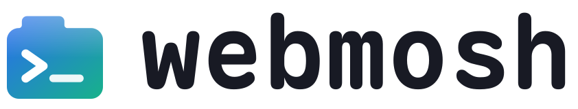
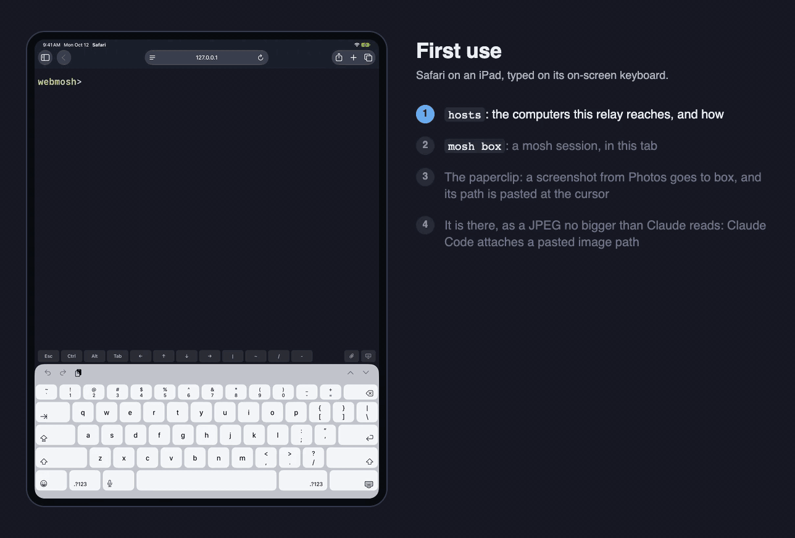
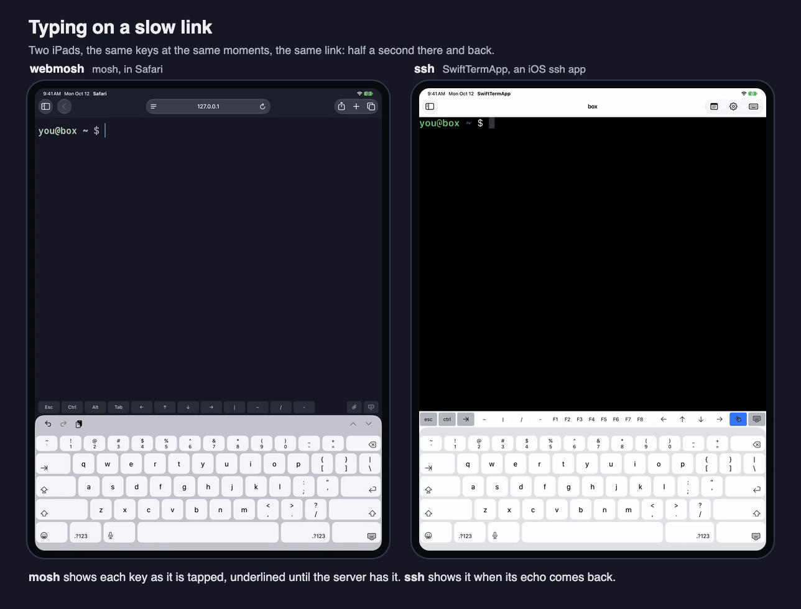
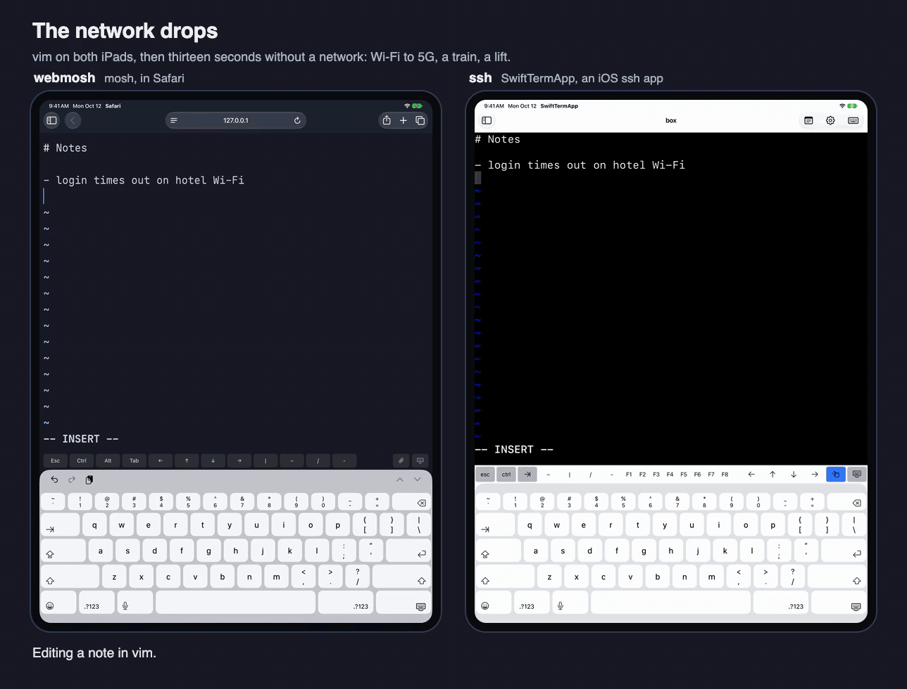
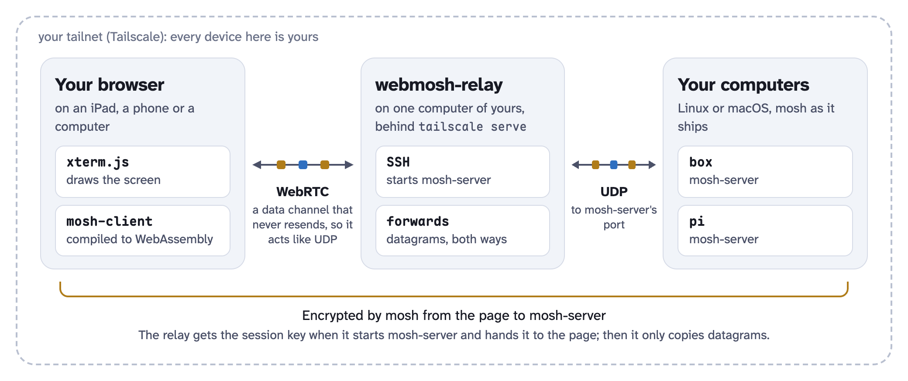

<p align="center">
  <picture>
    <source media="(prefers-color-scheme: dark)" srcset="docs/images/logo-lockup-dark.svg">
    
  </picture>
</p>

<p align="center"><b>Real <a href="https://mosh.org">mosh</a> in a browser tab.</b><br>
Any device with a browser, at its best on an iPad. No terminal app to install, no SSH keys on your devices.<br>
<b>Needs <a href="docs/install.md">Tailscale</a></b> on the relay's computer and on every device you use it from.</p>

<p align="center"><a href="#install">Install</a> · <a href="#why-mosh-not-ssh">Why mosh</a> ·
<a href="#what-you-get">What you get</a> · <a href="#documentation">Documentation</a></p>

<p align="center"><br>
<sub>First use on an iPad, typed on its on-screen keyboard: the hosts, mosh to one, a screenshot from Photos sent to it
with the paperclip, for Claude Code. (<a href="docs/images/ipad-3-first-use.mp4">video</a>)</sub></p>

## Install

On a Linux or macOS computer that stays on (it becomes the relay), with [Tailscale](https://tailscale.com/download)
signed in, HTTPS certificates on for the tailnet (Tailscale's admin console, DNS page) and mosh installed
(`brew install mosh`, `apt install mosh`):

```
curl -fsSLO https://github.com/williamliu0516/webmosh/releases/latest/download/install-relay.sh
less install-relay.sh     # read it first: it installs a service, with sudo
bash install-relay.sh     # prints the page's address when the relay is up
```

1. **Open that address** on your iPad, phone or computer, signed in to the same Tailscale account.
2. **Type `mosh <this computer's name>`.** The relay's own computer is your first host.
3. **More computers:** type `setup`, press **Set up** on one, and run the line it shows there.

Installed and tried on a Mac with Apple silicon and a PC with Ubuntu 24.04 (x86-64); in daily use on a Raspberry Pi 4.
Step by step with pictures, which computers, updating and doing it by hand: [Install](docs/install.md).

## Why mosh, not ssh

Two iPads, the same keys at the same moments, the same link to the same computer: webmosh in Safari on the left, an
ssh app on the right ([SwiftTermApp](https://github.com/migueldeicaza/SwiftTermApp), an open-source iOS ssh client).

**Typing on a slow link.** With half a second there and back, mosh shows each key as you tap it, underlined until
the server has it; ssh shows it when the server's echo comes back. (<a href="docs/images/ipad-1-slow-link.mp4">video</a>)



**The network drops.** mosh keeps taking keys, says how long since it last heard from the server, and picks up by
itself when the network is back, with what you typed meanwhile. The ssh app loses its connection: open the host
again, start vim again, and the line you had not saved is gone. (<a href="docs/images/ipad-2-network-drop.mp4">video</a>)



<sub>Recorded in Xcode's iPad simulator, both iPads at once, their on-screen keyboards tapped by a UI test. The link
is macOS's network emulator on one computer, alike for both; when the network goes, ssh's connection is reset, as it
is when a phone's network changes. The long wait plays faster, and the picture says so. Three more situations: a
lossy link, Ctrl-C on a runaway command, sleep ([Why mosh](docs/why-mosh.md)).</sub>

## What you get

- **Real mosh.** mosh-client runs in the page as WebAssembly: local echo, prediction, and sessions that ride out a
  network change and sleep.
- **Any device, any browser.** iPad, iPhone, Android, Mac, Windows, Linux, Chromebook, in Safari, Chrome, Edge or
  Firefox. Add it to the Home Screen and it is an app of its own.
- **Tabs that come back** after a reload or a killed app, in the same tmux sessions.
- **ssh tabs too,** held by the relay, with images (sixel, iTerm2) and scrollback.
- **A keyboard done right on each:** on an iPad Option as Meta, dead keys, Ctrl, Chinese input, trackpad selection
  and copy from tmux to the clipboard; on a phone a row of the keys its keyboard lacks.
- **Photos and files to the computer,** for Claude Code: the paperclip, Cmd Shift I, a paste or a drop. The file lands
  in `~/Downloads/webmosh` there and its path at the cursor; pictures shrink to the size Claude reads.
- **Every computer in one line.** The relay finds the Linux and macOS computers on your tailnet; one line run on each
  sets it up. A VPS or a server at work joins by its address.
- **No SSH keys on your devices.** Your Tailscale login is the way in; only the relay holds a key to your computers.
  A lost phone is a device to take off the tailnet.
- **Yours.** One binary on a Linux or macOS computer you already have; no account, no subscription. Your own fonts and
  colours, and a page you can put in a dashboard.

**For you if** you code from an iPad, want a terminal on your phone now and then, are on Windows or a Chromebook
(no mosh client of their own), or keep long jobs and agents in tmux and come back to them from anywhere. Not for
shared access: one owner per relay. Keys, devices and the rest: [Using it](docs/usage.md).

## How it works

mosh-client's core runs in the page as WebAssembly; a WebRTC data channel that never resends carries its encrypted
datagrams to a small relay on your tailnet, which forwards them to an unmodified `mosh-server`. Where the browser's
WebRTC cannot reach the relay (Firefox over Tailscale), a WebSocket of the session's own carries them instead.

<picture>
  <source media="(prefers-color-scheme: dark)" srcset="docs/images/architecture-dark.png">
  
</picture>

The connection step by step, the latency measured, building and the source layout: [How it works](docs/how-it-works.md).

## Security

The relay is a remote shell service: read [Security](docs/security.md) before you run it. In short:

- **Access is your Tailscale identity.** The relay listens on loopback behind `tailscale serve` and lets one login in.
  There is no other authentication: never publish it to the internet.
- **The relay is part of what you trust.** mosh is encrypted from the page to `mosh-server`, but the relay hands the
  page its session key; ssh tabs run on the relay itself.
- **Its key reaches each computer you set up,** through a forced command (`webmosh-gate`) that allows a login shell,
  mosh-server and a few chores, and no forwarding.

## Compared with other apps

Blink Shell and Termius are good apps, and both speak mosh. webmosh is for when an app is the wrong shape: no terminal
app to install and update on each device (Tailscale only), no SSH keys on them, no account and no subscription. What the apps do and
webmosh does not: work without a relay and a tailnet, a local shell, port forwarding, SFTP.
[The full comparison](docs/usage.md#compared-with-other-apps).

## Documentation

| | |
|---|---|
| [Using it](docs/usage.md) | commands and keys, tabs and what a reload keeps, devices and browsers, other apps |
| [Install](docs/install.md) | step by step, which computers, what the installer does, by hand |
| [Hosts](docs/hosts.md) | more computers: on the tailnet with one line, off it by address |
| [Configuration](docs/configuration.md) | `relay.json`, your own look, embedding the page |
| [Security](docs/security.md) | what is trusted, and what the relay's key may do |
| [How it works](docs/how-it-works.md) | the design, latency measured, building, the source layout |
| [Why mosh](docs/why-mosh.md) | three more situations, side by side with ssh |

## About

webmosh is an unofficial project and has nothing to do with the mosh authors. It was built for one setup (an iPad,
a Raspberry Pi and a few computers on a [Tailscale](https://tailscale.com) tailnet) and is published as it is used
there. Expect to read some code.

GPL version 3 or later (`COPYING`), as mosh. The WebAssembly module is built from mosh (GPLv3+), Nettle
(LGPLv3+ / GPLv2+) and Protocol Buffers (BSD-3-Clause); the page uses xterm.js (MIT) and the relay pion (MIT).
