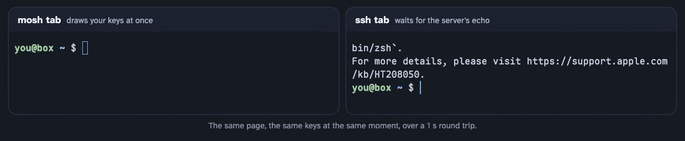

<p align="center">
  <picture>
    <source media="(prefers-color-scheme: dark)" srcset="docs/images/logo-lockup-dark.svg">
    
  </picture>
</p>

<p align="center"><b>Real <a href="https://mosh.org">mosh</a> in a browser tab.</b><br>
No terminal app on your devices. Your SSH keys stay on your own relay.</p>

<p align="center"></p>

<p align="center"><br>
<sub>Over a one-second round trip, mosh draws your keys as you type them; an ssh terminal shows each a second later.</sub></p>

## What you get

- **Real mosh:** local echo and prediction, and a session that rides out network changes and sleep.
- **Tabs that come back** after a reload or a killed app, back in the same tmux sessions.
- **ssh tabs too,** with images (sixel, iTerm2) and scrollback, held by the relay.
- **Photos and files** from the iPad to the remote computer, the path pasted at the cursor (Claude Code attaches it).
- **An iPad keyboard done right:** Option as Meta, dead keys, Ctrl, Chinese input, the keyboard bar out of the way.
- **Any Linux or macOS computer** as the relay, and any of them as a host, set up with one line.
- **Your own look:** fonts, colours, a picture behind the text, all CSS.

<details>
<summary>Commands, keys and how tabs survive a reload</summary>

| | |
|---|---|
| `mosh <host>` | mosh from the page (the WASM client) straight to that host's mosh-server |
| `ssh <host>` | a terminal the relay holds: images (sixel and iTerm2 inline images, e.g. yazi previews, also in tmux) and scrollback, and it survives a page reload |
| `hosts`, `help`, `clear` | `hosts` lists every host and whether it takes mosh, ssh or both |
| `exit`, Ctrl-D on an empty line | close the tab |
| Cmd Shift T / Cmd Shift W | new tab / close the tab (closing a session ends its mosh-server, through mosh's own shutdown) |
| Cmd Shift Left / Right (or [ / ]), Cmd 1..8, Cmd 9 | previous / next tab, that tab, the last tab |
| Up / Down, Tab | history, completion of commands and host names |
| Cmd = / Cmd - / Cmd 0 | font size, remembered |
| Cmd Shift I, Cmd V with a picture, a drop | photos and files to the tab's computer, kept in `~/Downloads/webmosh/` there; the path is pasted at the cursor (Claude Code attaches a pasted image path). HEIC becomes JPEG, at most 50 MB a file |
| Cmd Shift K, Ctrl Space | iPadOS's keyboard bar on / off (off by default); switch input sources with the bar off |

Each tab is a prompt or one session. Tabs share one xterm.js: only the tab on screen draws, and switching has that
tab's mosh client redraw the whole screen from the state it holds, with no round trip.

The iPad gets most of the attention: Option as Meta despite iPadOS dead keys, Ctrl keys sent by physical key,
Chinese input, trackpad drag selection inside kiosk browsers, the keyboard bar, and copying through OSC 52 (tmux's
`set-clipboard`) into the iPad clipboard, which Safari allows only inside a user gesture.

A reload cannot keep a mosh session: a new client cannot take over a live one, as starting again under the same key
would reuse its nonces. So the page remembers each tab's host and tmux session (from tmux's title,
`set-titles-string '#S · #W'`), opens the same tabs again after a reload and types
`tmux attach -t '=<session>' || tmux` into each new shell. What ran outside tmux is gone. The relay keeps a copy of
each device's tabs as well, since some iPad kiosk apps come back with empty storage. ssh tabs are held by the relay,
so a reload takes them up again as they were.

</details>

## Who it's for

- **You code from an iPad,** with a keyboard, on computers at home or in the cloud.
- **You run a homelab on Tailscale** and want one address for every computer on it.
- **You use several devices** and want the same terminal on each without setting up each.
- **You keep long jobs in tmux** (builds, agents, servers) and come back to them from wherever you are.
- **You build dashboards** and want a terminal inside one.

It is not for shared access (one owner per relay), and it needs a computer that stays on for the relay.

## How it works

mosh-client's core runs in the page as WebAssembly; a WebRTC data channel that never resends carries its encrypted
datagrams to a small relay, which forwards them to an unmodified `mosh-server`.

<picture>
  <source media="(prefers-color-scheme: dark)" srcset="docs/images/architecture-dark.png">
  
</picture>

<picture>
  <source media="(prefers-color-scheme: dark)" srcset="docs/images/sequence-dark.png">
  
</picture>

<picture>
  <source media="(prefers-color-scheme: dark)" srcset="docs/images/latency-dark.png">
  
</picture>

## Getting started

No Raspberry Pi needed: the relay runs on any Linux or macOS computer on your tailnet that stays on, such as a Mac
mini or an iMac, a home server or NAS, a Raspberry Pi, or a small cloud server with Tailscale on it.

**One computer is enough.** The relay's own computer is also your first host (a target with `local: true`), so a Mac
and an iPad make a whole setup; other computers join later as hosts. Targets need `mosh-server`, and sshd unless the
target is the relay's own computer. A MacBook works while it is awake: keep it on power with automatic sleep off
(a closed lid without a display puts it to sleep, and the relay with it).

| Relay on | Binary (`scripts/build-all.sh`) | Service | Tested |
|---|---|---|---|
| macOS, Apple silicon | `webmosh-relay-darwin-arm64` | launchd: `relay/service/webmosh.relay.plist` | the tests, the launchd service, tailnet discovery |
| Linux, x86-64 (PCs, servers, most cloud machines) | `webmosh-relay-linux-amd64` | systemd: `relay/service/webmosh-relay.service` | built, not run yet |
| Linux, 64-bit ARM (Raspberry Pi 3, 4, 5, ARM servers) | `webmosh-relay-linux-arm64` | systemd | in daily use on a Raspberry Pi 4 |
| macOS, Intel | `webmosh-relay-darwin-amd64` | launchd | built, not run yet |
| Linux, 32-bit ARM (Raspberry Pi OS 32-bit, Pi Zero) | `webmosh-relay-linux-arm` | systemd | built, not run yet |
| Windows | none: no mosh-server and no Unix terminals there (WSL 2 might do; untested) | | |

On the relay's computer, with [Tailscale](https://tailscale.com/download) and mosh installed (`brew install mosh`,
`apt install mosh`):

```
curl -fsSLO https://github.com/williamliu0516/webmosh/releases/latest/download/install-relay.sh
less install-relay.sh     # read it first: it installs a service, with sudo
bash install-relay.sh     # prints the page's address when the relay is up
```

The installer downloads the relay for this computer from the latest release (or `--version v1.2.3`) and checks it
against the release's `SHA256SUMS`. It reads the computer's tailnet name and your login from Tailscale, writes
`~/.config/webmosh/relay.json` with this computer as the first host (kept on later runs), installs the launchd or
systemd service, lets the relay through the macOS firewall when that is on, and publishes the page with
`tailscale serve --https=8445`. Run it again to update; `--dry-run` shows what it would do, `--uninstall` takes it
away. Tailscale must have HTTPS certificates on for the tailnet (admin console, DNS page). In a clone of this
repository it installs your own build instead: `scripts/build-all.sh && scripts/install-relay.sh`. Tried so far: on a
Mac with Apple silicon, from a build and from release files (install, a mosh and an ssh session over the tailnet,
update, uninstall), and on a Raspberry Pi as dry runs.

<details>
<summary>By hand</summary>

1. Copy the binary for the relay's computer there, as `webmosh-relay`.
2. Make an SSH key for the relay (`ssh-keygen -t ed25519 -f ~/.config/webmosh/id_ed25519 -N ''`) and write
   `~/.config/webmosh/relay.json` (start from `relay/relay.example.json`; fields below).
3. Install the service file for its system, with your user and paths in place of `you`; each file says how.
4. Publish it to the tailnet: `tailscale serve --bg --https=8445 http://127.0.0.1:8810`. On macOS the command is
   inside the app: `/Applications/Tailscale.app/Contents/MacOS/Tailscale serve ...` (the relay finds it there by
   itself). The page is then at `https://<relay host>.<tailnet>.ts.net:8445`, which is also the config's `origin`.

On macOS, if the firewall is on, allow `webmosh-relay` to accept incoming connections (System Settings > Network >
Firewall > Options): WebRTC and TURN take UDP from the browser.

</details>

### Hosts

A target in the config is fixed: `local: true` runs mosh-server on the relay's own computer; otherwise the relay
logs in over SSH with its key to `host` as `user`.

Every Linux or macOS computer on the tailnet can also be a host without editing the config. The relay reads
`tailscale status --json` every minute and lists the computers it finds. The hosts API sets one up:

```
R=https://<relay host>.<tailnet>.ts.net:8445
curl -s $R/api/hosts                                              # computers, their state and node ids
curl -s -H "Origin: $R" -d '{"node":"<node id>"}' $R/api/hosts/setup   # the setup line, valid 30 minutes
# run that line on the computer, as the user the terminal should log in as
curl -s -H "Origin: $R" -d '{"node":"<node id>","name":"box","aliases":["b"]}' $R/api/hosts/update
```

Also `POST /api/hosts/test` (log in again and check), `forget` and `update` with `"off": true` or `"port"`. These
need the owner's identity, so run them from one of your tailnet devices. The setup line installs the gate, adds the
key's line and reports the user, where mosh-server is and the computer's SSH host key, which the relay pins; the
relay then logs in and checks. The prompt then takes `ssh box` and, with mosh installed, `mosh box`. To undo it on
the computer: `sed -i.bak '/webmosh-relay@<relay host>/d' ~/.ssh/authorized_keys && rm ~/.local/bin/webmosh-gate`.

Names are unique per protocol, not overall: `mosh box` and `ssh box` may reach different hosts. The config's
targets come first, then the hosts in the order they were first seen.

## Security

Read this before running it. The relay is a remote shell service.

- **Access is your Tailscale identity.** The relay listens on loopback behind `tailscale serve`, which adds a
  `Tailscale-User-Login` header to every request from the tailnet. Only the configured `owner` gets in, and the
  header is trusted only from loopback. The WebSocket and the hosts API also check the request's `Origin`. There is
  no other authentication, so never publish the relay to the internet (no Funnel, no port forward), and run it on a
  computer where nobody else can reach its loopback port.
- **The relay is trusted with your sessions.** mosh's datagrams are encrypted end to end between the page and
  `mosh-server`, and the relay only forwards them. But the relay starts `mosh-server` and reads the session key to
  hand it to the page, and keeps it in its state file so that sessions survive a restart. Whoever controls the relay
  can read mosh sessions. ssh tabs run on the relay itself, in plaintext.
- **The relay's SSH key reaches every host you set up.** On each host, one `authorized_keys` line lets it in:
  `from=` the relay's tailnet addresses only, `restrict,pty` (no forwarding of any kind), and a forced command,
  `webmosh-gate`, which allows a login shell, mosh-server with fixed options, ending a mosh-server, receiving an
  uploaded file and a status check. A login shell is a login shell: if the relay is compromised, so is every host's
  user that was set up.
- **The setup line is `curl | sh`.** It carries a token for that one computer, valid for 30 minutes (a new line
  replaces it). Read `relay/setup/setup.sh` before running it; it changes only that user's `~/.ssh/authorized_keys` (one line,
  with a backup of the old file) and `~/.local/bin/webmosh-gate`.
- **ntfy.** If `ntfy_topic` is set, new tailnet computers are announced there. Anyone who knows a topic's name can
  read it, so use a long random one.
- **Diagnostics.** The page reports keyboard and pointer events with modifiers (Option, Ctrl, dead keys) to the
  relay's journal for debugging the iPad. Plain letters and input method text are never reported.

## Configuration

`relay.json`:

| Field | |
|---|---|
| `listen` | where the relay listens; default `127.0.0.1:8810` |
| `origin` | the page's address as the browser sees it (`tailscale serve`'s) |
| `owner` | the Tailscale login let in; empty turns the check off (development only) |
| `ice_nets`, `turn_listen` | where WebRTC may listen (e.g. `["100.64.0.0/10"]`, the tailnet), and an optional TURN server on the relay's tailnet address (Safari can hide its host addresses; TURN is the fallback) |
| `ssh_key`, `known_hosts` | the relay's key, and the host keys of config targets |
| `detached_ttl` | how long a session waits for its page; default `12h` |
| `state_dir` | sessions, hosts and device tabs; default systemd's `StateDirectory=`, else `~/Library/Application Support/webmosh` (macOS) or `~/.local/state/webmosh` |
| `targets` | `id`, `name`, `aliases`, `host`, `user`, `mosh_server`, `locale`, `local`, `env`, `args`, `end_via_ssh` |
| `default_target` | |
| `frame_ancestors` | origins that may embed the page in an iframe and use the hosts API |
| `lang` | `en` (default) or `zh`: the page's and the relay's own messages |
| `page` | the look, served to the page as `/site.json`: `theme` (an xterm.js theme laid over the default, Tomorrow Night) and `terminal` (xterm.js options such as `lineHeight`, `cursorStyle`) |
| `static_dir` | files served in place of the built-in ones (below) |
| `ssh_from`, `hosts_scan`, `tailscale_status` | tailnet hosts: extra addresses for the key's `from=`, how often to read tailscale status (default `1m`), a status file instead (tests) |
| `ntfy_server`, `ntfy_topic`, `hosts_page` | announce new tailnet computers on ntfy, with a link to your hosts page |

### Your own look

Put a `custom.css` in `static_dir`: the page loads it after its own styles, and the relay serves the fonts and
pictures it names from the same directory. An `@font-face` named `webmosh-mono` becomes the terminal's font
(`scripts/build-fonts.sh` subsets a Nerd Font for it); `web/src/custom.css` shows an example. A transparent theme
background (`"background": "#1d1f2100"` with `"terminal": {"allowTransparency": true}`) lets a picture behind the
page show through the cells.

### Embedding

The page can live in an iframe of another page (a wall panel, say) that is listed in `frame_ancestors`. The parent
posts `webmosh:focus` and `webmosh:hide` when it shows and hides the terminal, and `{t: 'webmosh:open', kind, target}`
to open a tab; the page posts `webmosh:active` while someone types, `webmosh:close` (`exit` at the last prompt) and
`webmosh:toggle` (Cmd Shift H). `GET /api/device` tells the parent whether the terminal was on screen when that
device was last seen.

## Compared with other apps

Blink Shell and Termius are good apps, and both speak mosh. webmosh is for when an app is the wrong shape.

- **No terminal app on your devices.** Any browser on your tailnet is the client, and an update happens once, on the
  relay. Each device still needs Tailscale.
- **No SSH keys on your devices.** You get in by your Tailscale identity; only the relay holds a key to your computers,
  limited to what `webmosh-gate` allows. A lost iPad is a device to remove from the tailnet.
- **Yours, and open.** No account, no subscription, no vendor's cloud: one Go binary on a computer you already have.

| | Runs in | mosh | Where your SSH keys live | |
|---|---|---|---|---|
| webmosh | a browser on your tailnet | yes: mosh-client in WebAssembly | on your relay only | free, GPL |
| Blink Shell | an iPhone and iPad app | yes | on each device | App Store app, GPL source |
| Termius | iOS, Android and desktop apps | yes | on each device, or Termius's encrypted vault | free tier and subscription |
| Chrome's Secure Shell | a Chrome extension | alpha, through Chrome's own sockets: no Safari, no iPad | on each device | free, open source |
| ttyd, wetty, sshx | any browser | no: WebSocket, no prediction, a network change drops it | on the server | free, open source |

What the apps do and webmosh does not: work without a relay and a tailnet, a local shell, port forwarding, SFTP.
And the relay is part of what you trust (see [Security](#security)).

## Building

Needs `emscripten`, `cmake`, `go` and Node (Homebrew on macOS).

```
scripts/fetch-deps.sh && scripts/build-deps.sh     # once: pinned mosh 1.4.0, protobuf 21.12, nettle 3.10.2
(cd web && npm install)
scripts/build-all.sh                               # wasm + page + a relay for this computer and each platform -> build/relay
```

Releases: pushing a tag `v*` runs `.github/workflows/release.yml`, which builds the relay for every platform on
GitHub's Linux machines (the same pinned mosh, protobuf, nettle and emscripten 6.0.11) and publishes the binaries
with `install-relay.sh`, the service files and `SHA256SUMS`. Run by hand, it builds them as an artifact only.

Measured (the chart above): with 150 ms added each way on loopback, the WebAssembly client against the native
mosh-client 1.4.0, three runs each. On an iPad over a tailnet a session opens in about 1.7 s, and a relay restart is
back in under a second.

## Layout

| Path | What |
|---|---|
| `wasm/webmosh.cc` | the module's API (`wm_*`): stmclient.cc's loop turned into calls per event |
| `wasm/override/network.h`, `network_web.cc` | mosh's `Connection` without sockets: datagrams queue to and from JS |
| `wasm/override/terminaldisplayinit_web.cc` | `Display` without terminfo (the local terminal is always xterm.js) |
| `web/src/app.mjs` | the page: xterm.js, signaling, WebRTC attach and reattach, clipboard, keyboard |
| `web/src/client.mjs`, `ptyclient.mjs` | a mosh session (one module instance), an ssh session |
| `web/src/prompt.mjs`, `tabs.mjs` | the `webmosh>` prompt, the tab bar |
| `web/src/keys.mjs`, `keytest.mjs` | keyboard mapping (Option as Meta, iPad dead keys), the `?keytest` sweep |
| `web/src/upload.mjs` | photos and files to the tab's computer |
| `web/src/theme.mjs`, `i18n.mjs`, `custom.css` | default colours, English and Chinese, the placeholder for a deployment's styles |
| `relay/` | the relay (Go, pion WebRTC with an embedded TURN server), with the page embedded |
| `relay/hosts.go`, `relay/setup/` | tailnet hosts, the setup script and `webmosh-gate` |
| `relay/pty.go` | ssh tabs: the relay's terminal and its output ring |

mosh itself is used as it is: `scripts/build-wasm.sh` stages mosh's sources and drops the three overrides in.

## About

webmosh is an unofficial project and has nothing to do with the mosh authors. It was built for one setup (an iPad,
a Raspberry Pi and a few computers on a [Tailscale](https://tailscale.com) tailnet) and is published as it is used
there. Expect to read some code.

GPL version 3 or later (`COPYING`), as mosh. The WebAssembly module is built from mosh (GPLv3+), Nettle
(LGPLv3+ / GPLv2+) and Protocol Buffers (BSD-3-Clause); the page uses xterm.js (MIT) and the relay pion (MIT).
