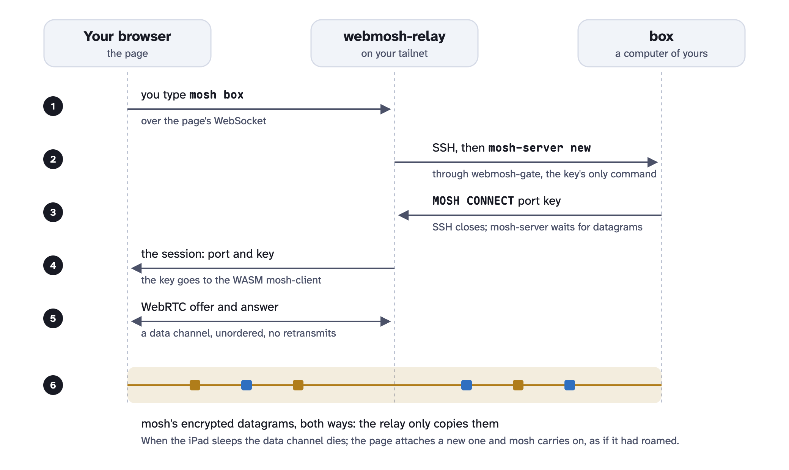
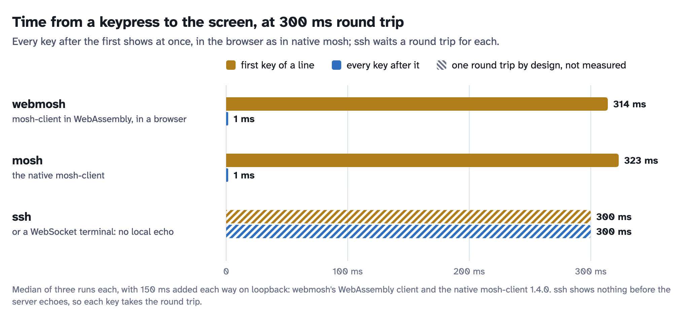

# How it works

[README](../README.md) · [Using it](usage.md) · [Install](install.md) · [Hosts](hosts.md) ·
[Configuration](configuration.md) · [Security](security.md) · **How it works**

mosh-client's core runs in the page as WebAssembly; a WebRTC data channel that never resends carries its encrypted
datagrams to a small relay, which forwards them to an unmodified `mosh-server`. Where the browser's WebRTC cannot
reach the relay (Firefox over Tailscale), a WebSocket of the session's own carries them instead.

<picture>
  <source media="(prefers-color-scheme: dark)" srcset="images/architecture-dark.png">
  
</picture>

<picture>
  <source media="(prefers-color-scheme: dark)" srcset="images/sequence-dark.png">
  
</picture>

<picture>
  <source media="(prefers-color-scheme: dark)" srcset="images/latency-dark.png">
  
</picture>

Measured (the chart): with 150 ms added each way on loopback, the WebAssembly client against the native
mosh-client 1.4.0, three runs each. On an iPad over a tailnet a session opens in about 1.7 s, and a relay restart is
back in under a second.

More situations where mosh and ssh part ways, two iPads side by side: [Why mosh](why-mosh.md).

## Building

Needs `emscripten`, `cmake`, `go` and Node (Homebrew on macOS).

```
scripts/fetch-deps.sh && scripts/build-deps.sh     # once: pinned mosh 1.4.0, protobuf 21.12, nettle 3.10.2
(cd web && npm install)
scripts/build-all.sh                               # wasm + page + a relay for this computer and each platform -> build/relay
```

Releases: pushing a tag `v*` runs `.github/workflows/release.yml`, which builds the relay for every platform on
GitHub's Linux machines (the same pinned mosh, protobuf, nettle and emscripten 6.0.11) and publishes the binaries
with `install-relay.sh`, the service files and `SHA256SUMS`. Run by hand, it builds them as an artifact only.

## Layout

| Path | What |
|---|---|
| `wasm/webmosh.cc` | the module's API (`wm_*`): stmclient.cc's loop turned into calls per event |
| `wasm/override/network.h`, `network_web.cc` | mosh's `Connection` without sockets: datagrams queue to and from JS |
| `wasm/override/terminaldisplayinit_web.cc` | `Display` without terminfo (the local terminal is always xterm.js) |
| `web/src/app.mjs` | the page: xterm.js, signaling, WebRTC attach and reattach, clipboard, keyboard |
| `web/src/client.mjs`, `ptyclient.mjs` | a mosh session (one module instance), an ssh session |
| `web/src/prompt.mjs`, `tabs.mjs` | the `webmosh>` prompt, the tab bar |
| `web/src/keys.mjs`, `keytest.mjs` | keyboard mapping (Option as Meta, iPad dead keys), the `?keytest` sweep |
| `web/src/upload.mjs` | photos and files to the tab's computer |
| `web/src/hosts.mjs` | the hosts page (`setup`, `?hosts`) |
| `web/src/keyrow.mjs`, `platform.mjs`, `fontsize.mjs` | the key row on touch screens, the keys off Apple keyboards, the font size |
| `web/src/theme.mjs`, `i18n.mjs`, `custom.css` | default colours, English and Chinese, the placeholder for a deployment's styles |
| `relay/` | the relay (Go, pion WebRTC with an embedded TURN server), with the page embedded |
| `relay/session.go`, `mosh.go` | a session and the link attached to it; starting and ending mosh-server |
| `relay/link.go` | a session's WebSocket, where the browser's WebRTC cannot reach the relay (Firefox) |
| `relay/hosts.go`, `relay/setup/` | hosts on the tailnet and off it, the setup script and `webmosh-gate` |
| `relay/pty.go` | ssh tabs: the relay's terminal and its output ring |
| `relay/devices.go`, `upload.go` | each device's tabs, kept for a page that comes back with empty storage; uploads |
| `scripts/install-relay.sh`, `relay/service/` | the installer, and the launchd and systemd service files |

mosh itself is used as it is: `scripts/build-wasm.sh` stages mosh's sources and drops the three overrides in.
