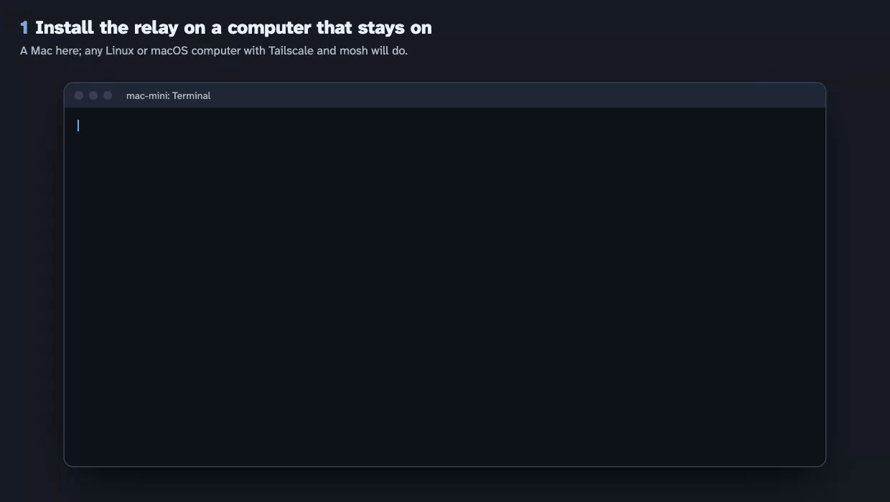
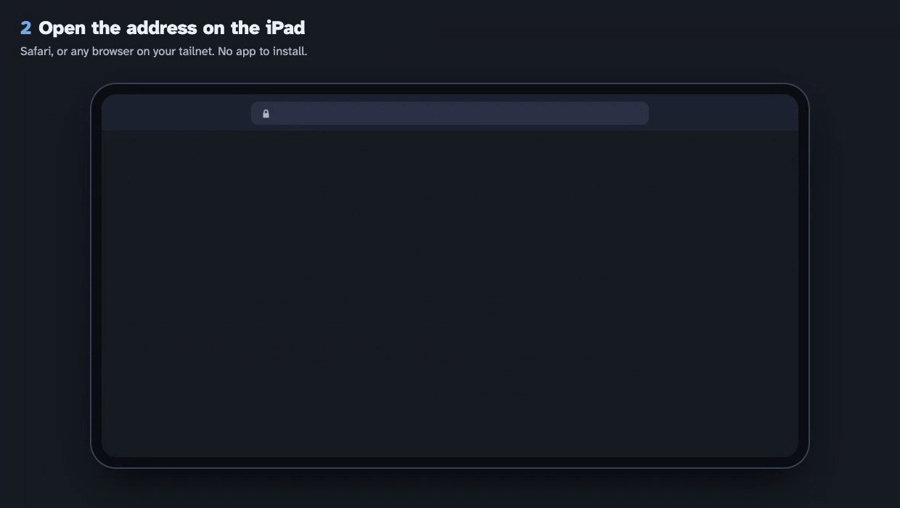
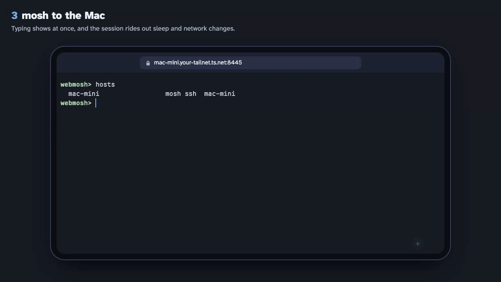
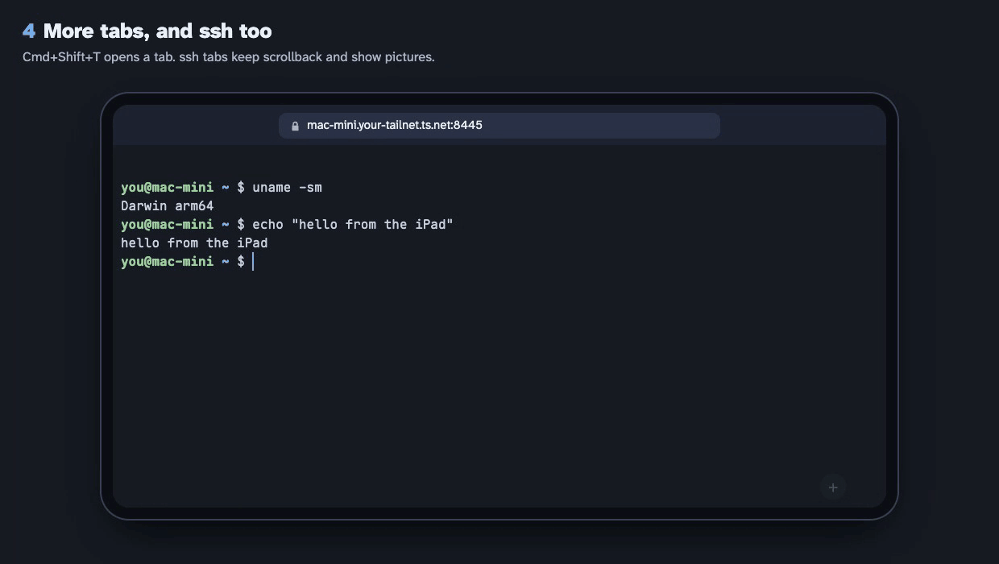

# Install

[README](../README.md) · [Using it](usage.md) · **Install** · [Hosts](hosts.md) · [Configuration](configuration.md) ·
[Security](security.md) · [How it works](how-it-works.md)

> [!IMPORTANT]
> **webmosh needs [Tailscale](https://tailscale.com/download).** The relay is reachable only on your tailnet, and
> your Tailscale login is the only way in (there is no password). Install Tailscale on the relay's computer and on
> every device you open webmosh on (iPad, phone, computer), each signed in with the same Tailscale account. The free
> Personal plan is enough. Only the relay and your devices need it: a computer you connect to, such as a VPS, can stay
> off the tailnet and be added by its address ([Hosts](hosts.md)).

## Step by step

1. **Install the relay** on a Linux or macOS computer that stays on, with Tailscale signed in, HTTPS certificates on
   for the tailnet (Tailscale's admin console, DNS page) and mosh installed (`brew install mosh`, `apt install mosh`):

   ```
   curl -fsSLO https://github.com/williamliu0516/webmosh/releases/latest/download/install-relay.sh
   less install-relay.sh     # read it first: it installs a service, with sudo
   bash install-relay.sh     # prints the page's address when the relay is up
   ```

   (<a href="images/install-1-relay.mp4">video</a>)

   

2. **Open its address** on your iPad, phone or computer, in any browser ([devices](usage.md#devices-and-browsers)).
   On an iPad or a phone, Safari's Share > Add to Home Screen gives it a full screen of its own.
   (<a href="images/install-2-open.mp4">video</a>)

   

3. **mosh to it.** (<a href="images/install-3-mosh.mp4">video</a>)

   

4. **More tabs, and ssh too.** (<a href="images/install-4-tabs.mp4">video</a>)

   

5. **More computers.** Type `setup`: the hosts page lists the other computers on your tailnet. Press **Set up** on
   one, copy the line it shows, and run it in a terminal on that computer; the row turns ready, and `mosh <name>` and
   `ssh <name>` reach it ([Hosts](hosts.md)). A computer off the tailnet, such as a VPS, is added there by its address.

<sub>The installer's output is real, from a sandbox with a made-up machine name; the iPad is the real page.</sub>

## Which computer

No Raspberry Pi needed: the relay runs on any Linux or macOS computer on your tailnet that stays on, such as a Mac
mini or an iMac, a home server or NAS, a Raspberry Pi, or a small cloud server with Tailscale on it.

**One computer is enough.** The relay's own computer is also your first host (a target with `local: true`), so a Mac
and an iPad make a whole setup; other computers join later as hosts. Targets need `mosh-server`, and sshd unless the
target is the relay's own computer. A MacBook works while it is awake: keep it on power with automatic sleep off
(a closed lid without a display puts it to sleep, and the relay with it).

| Relay on | Binary (`scripts/build-all.sh`) | Service | Tested |
|---|---|---|---|
| macOS, Apple silicon | `webmosh-relay-darwin-arm64` | launchd: `relay/service/webmosh.relay.plist` | the tests, the launchd service, tailnet discovery |
| Linux, x86-64 (PCs, servers, most cloud machines) | `webmosh-relay-linux-amd64` | systemd: `relay/service/webmosh-relay.service` | release files on Ubuntu 24.04: install, mosh and ssh sessions, update, uninstall |
| Linux, 64-bit ARM (Raspberry Pi 3, 4, 5, ARM servers) | `webmosh-relay-linux-arm64` | systemd | in daily use on a Raspberry Pi 4 |
| macOS, Intel | `webmosh-relay-darwin-amd64` | launchd | built, not run yet |
| Linux, 32-bit ARM (Raspberry Pi OS 32-bit, Pi Zero) | `webmosh-relay-linux-arm` | systemd | built, not run yet |
| Windows | none: no mosh-server and no Unix terminals there (WSL 2 might do; untested) | | |

## What the installer does

It downloads the relay for this computer from the latest release (or `--version v1.2.3`) and checks it against the
release's `SHA256SUMS`. It reads the computer's tailnet name and your login from Tailscale, writes
`~/.config/webmosh/relay.json` with this computer as the first host (kept on later runs), installs the launchd or
systemd service, lets the relay through the macOS firewall when that is on, and publishes the page with
`tailscale serve --https=8445` (on Linux with sudo, unless you are Tailscale's operator: `tailscale set --operator`).
`--dry-run` shows what it would do, `--uninstall` takes it away; without Tailscale signed in, or without HTTPS
certificates on for the tailnet, it stops and says so. In a clone of this repository it installs your own build
instead: `scripts/build-all.sh && scripts/install-relay.sh`. Tried so far: on a Mac with Apple silicon, from a build
and from release files (install, a mosh and an ssh session over the tailnet, update, uninstall), the same from release
files on an x86-64 PC with Ubuntu 24.04, and on a Raspberry Pi as dry runs.

**Updating:** run it again. When a release's notes say the gate changed, set each host up again too
([Hosts](hosts.md)).

<details>
<summary>By hand</summary>

1. Copy the binary for the relay's computer there, as `webmosh-relay`.
2. Make an SSH key for the relay (`ssh-keygen -t ed25519 -f ~/.config/webmosh/id_ed25519 -N ''`) and write
   `~/.config/webmosh/relay.json` (start from `relay/relay.example.json`; fields in [Configuration](configuration.md)).
3. Install the service file for its system, with your user and paths in place of `you`; each file says how.
4. Publish it to the tailnet: `tailscale serve --bg --https=8445 http://127.0.0.1:8810`. On macOS the command is
   inside the app: `/Applications/Tailscale.app/Contents/MacOS/Tailscale serve ...` (the relay finds it there by
   itself). The page is then at `https://<relay host>.<tailnet>.ts.net:8445`, which is also the config's `origin`.

On macOS, if the firewall is on, allow `webmosh-relay` to accept incoming connections (System Settings > Network >
Firewall > Options): WebRTC and TURN take UDP from the browser.

</details>
