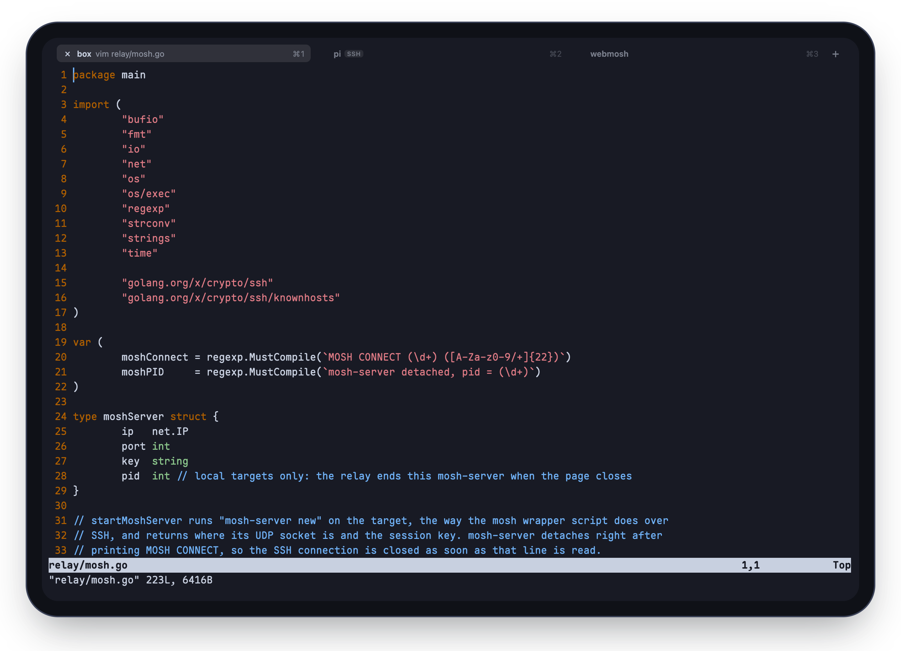

# Using webmosh

[README](../README.md) · **Using it** · [Install](install.md) · [Hosts](hosts.md) · [Configuration](configuration.md) ·
[Security](security.md) · [How it works](how-it-works.md)

## Commands and keys

At the `webmosh>` prompt of a new tab:

| | |
|---|---|
| `mosh <host>` | mosh from the page (the WASM client) straight to that host's mosh-server |
| `ssh <host>` | a terminal the relay holds: images (sixel and iTerm2 inline images, e.g. yazi previews, also in tmux) and scrollback, and it survives a page reload |
| `hosts`, `help`, `clear` | `hosts` lists every host and whether it takes mosh, ssh or both |
| `setup` | the hosts page, over the terminal: set up another computer of the tailnet, or add one off it by its address; names and aliases, a test, turning one off (also `?hosts` in the address); see [Hosts](hosts.md) |
| `exit`, Ctrl-D on an empty line | close the tab |
| Up / Down, Tab | history, completion of commands and host names |

Anywhere:

| | |
|---|---|
| Cmd Shift T / Cmd Shift W | new tab / close the tab (closing a session ends its mosh-server, through mosh's own shutdown) |
| Cmd Shift Left / Right (or [ / ]), Cmd 1..8, Cmd 9 | previous / next tab, that tab, the last tab |
| Cmd = / Cmd - / Cmd 0 | font size, remembered; Cmd 0 is the default (`page.terminal.fontSize`, else 15) |
| Cmd Shift I (on a touch screen also the paperclip), Cmd V with a picture, a drop | photos and files to the tab's computer, kept in `~/Downloads/webmosh/` there; the path is pasted at the cursor (Claude Code attaches a pasted image path). HEIC, and a picture over 1 MB or bigger than Claude reads (2576 px, 3.75 MP), becomes JPEG at most that size; at most 50 MB a file |
| Cmd Shift K, Ctrl Space | the on-screen keyboard and iPadOS's keyboard bar away / back (`page.keyboard` in the [configuration](configuration.md)); switch input sources with the bar away |
| a touch screen | under the terminal, the keys its keyboard lacks: Esc, Ctrl, Alt, Tab, the arrows, `\|` `~` `/` `-`; Ctrl and Alt hold for the next key, typed or tapped; a paperclip for photos and files; the last key puts the keyboard away, a button in the corner brings it back (the paperclip goes there too) |

On Windows, Linux, ChromeOS and Android keyboards the page's keys take Alt Shift in place of Cmd and Cmd Shift
(Alt Shift T, Alt Shift 1), since the system and the browser keep the others; Ctrl Shift C and Ctrl Shift V copy and
paste, and the font size is the browser's zoom.

## Tabs, and what a reload keeps

Each tab is a prompt or one session. Tabs share one xterm.js: only the tab on screen draws, and switching has that
tab's mosh client redraw the whole screen from the state it holds, with no round trip.

A reload cannot keep a mosh session: a new client cannot take over a live one, as starting again under the same key
would reuse its nonces. So the page remembers each tab's host and tmux session (from tmux's title,
`set-titles-string '#S · #W'`), opens the same tabs again after a reload and types
`tmux attach -t '=<session>' || tmux` into each new shell. What ran outside tmux is gone. The relay keeps a copy of
each device's tabs as well, since some iPad kiosk apps come back with empty storage. ssh tabs are held by the relay,
so a reload takes them up again as they were.

## Devices and browsers

| Device | What you get | Tried on |
|---|---|---|
| **iPad** | The best fit. Full screen in Safari or a kiosk app, like an app of its own; a Magic Keyboard with Option as Meta, dead keys and Chinese input; trackpad selection; copy from tmux into the iPad's clipboard; photos and files to the remote. The keyboard bar can go (`page.keyboard`). | real iPads: Safari, kiosk apps, an app embedding the page |
| **Phone** | The on-screen keyboard, and above it a row of what it lacks: Esc, Ctrl and Alt for the next key, Tab, arrows that repeat, `\|` `~` `/` `-`, and a paperclip for photos and files. The terminal ends above the keyboard. | a real iPhone (Safari); other phones only emulated so far |
| **Computer** | Mac, Windows, Linux, ChromeOS, in Chrome, Edge, Safari, Firefox (below) or another Chromium browser. Off Apple keyboards the page's keys are Alt Shift ones, and Ctrl Shift C / V copy and paste. | Chrome on a Mac; a Windows keyboard emulated |
| **Firefox** | Works, over a WebSocket where the others use WebRTC: Firefox offers WebRTC no address on the Tailscale interface. A lost packet then holds up the screen, as with ssh; the prediction, roaming and sessions that outlive the connection stay. Any browser whose WebRTC cannot reach the relay moves there after two tries. | Firefox on a Mac; Chrome with WebRTC blocked |

**Every device needs Tailscale,** signed in with the same Tailscale account as the relay ([Install](install.md)).

The iPad gets most of the attention: Option as Meta despite iPadOS dead keys, Ctrl keys sent by physical key,
Chinese input, trackpad drag selection inside kiosk browsers, the keyboard bar, and copying through OSC 52 (tmux's
`set-clipboard`) into the iPad clipboard, which Safari allows only inside a user gesture.

## Compared with other apps

Blink Shell and Termius are good apps, and both speak mosh. webmosh is for when an app is the wrong shape.

| | Runs in | mosh | Where your SSH keys live | |
|---|---|---|---|---|
| webmosh | a browser on your tailnet | yes: mosh-client in WebAssembly | on your relay only | free, GPL |
| Blink Shell | an iPhone and iPad app | yes | on each device | App Store app, GPL source |
| mosh's own client | macOS, Linux; Windows only through WSL | yes | on each device | free, GPL |
| Termius | iOS, Android and desktop apps | yes | on each device, or Termius's encrypted vault | free tier and subscription |
| Chrome's Secure Shell | a Chrome extension | alpha, through Chrome's own sockets: no Safari, no iPad | on each device | free, open source |
| ttyd, wetty, sshx | any browser | no: WebSocket, no prediction, a network change drops it | on the server | free, open source |

What the apps do and webmosh does not: work without a relay and a tailnet, a local shell, port forwarding, SFTP.
And the relay is part of what you trust (see [Security](security.md)).
