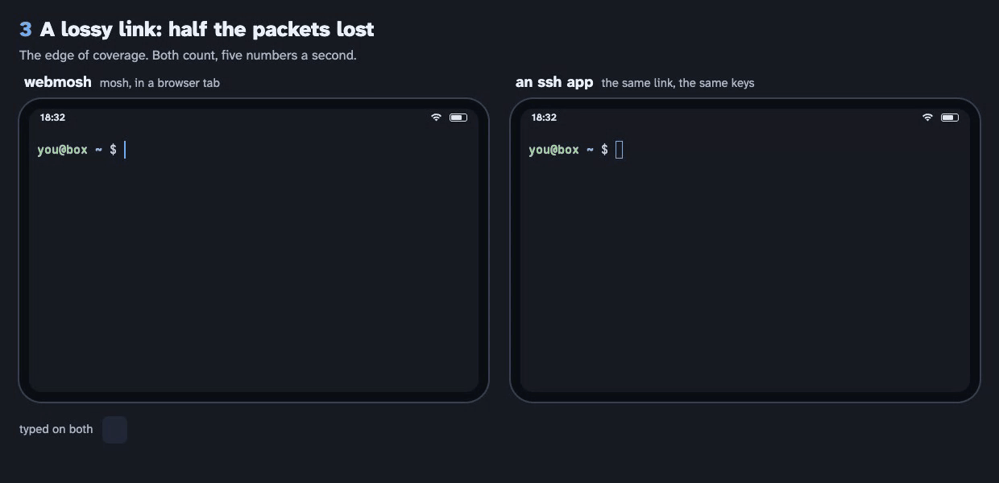
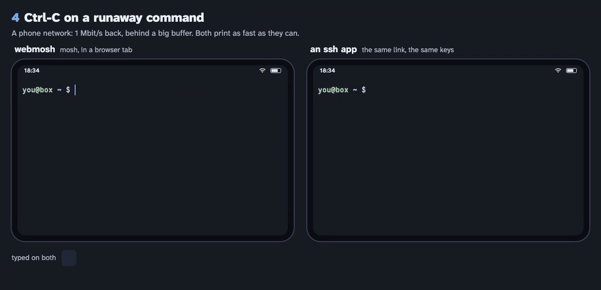
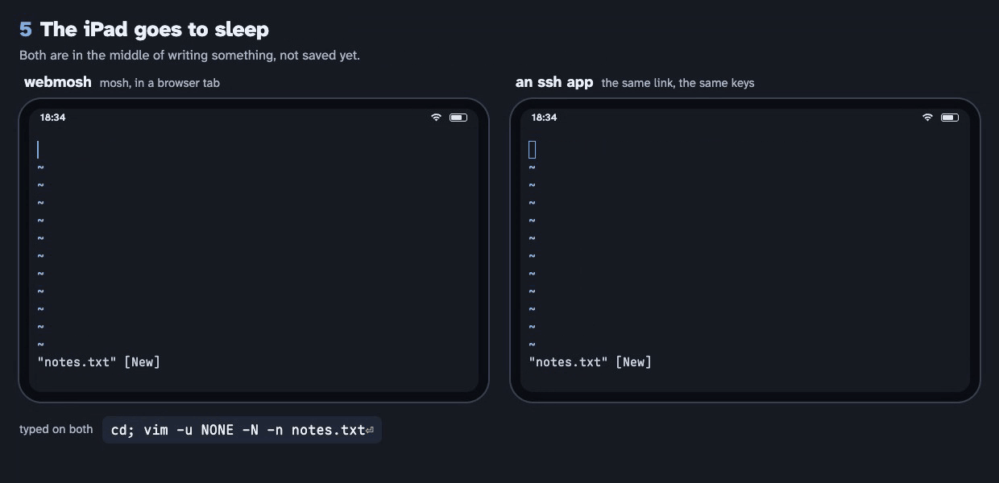

# Why mosh, not ssh

[README](../README.md) · [Using it](usage.md) · [Install](install.md) · [Hosts](hosts.md) ·
[Configuration](configuration.md) · [Security](security.md) · [How it works](how-it-works.md)

The [README](../README.md#why-mosh-not-ssh) shows typing over a slow link and the network dropping, on two simulated
iPads. Three more situations, from an earlier set of pictures: two iPads drawn in Chrome, webmosh on the left and a
real OpenSSH on the right (in a terminal of the same page, so the two look alike), the same keys at the same moment.
The link is macOS's network emulator (dummynet), alike for both. Seconds where nothing moves are cut, and the pictures
say so.

## Half the packets lost

At the edge of coverage webmosh keeps counting; ssh stalls for seconds while TCP waits to resend, and falls behind.
(<a href="images/demo-3-lossy-link.mp4">video</a>)

## Ctrl-C on a runaway command

On a slow phone link with a big buffer, webmosh stops at once: it only ever sends the latest screen. ssh scrolls on
through everything it was already sent. (<a href="images/demo-4-ctrl-c.mp4">video</a>)

## The iPad goes to sleep mid-edit

Afterwards the first key in ssh gets "Broken pipe", and the editor with the unsaved text is gone; webmosh is right
where it was. (<a href="images/demo-5-sleep.mp4">video</a>)

